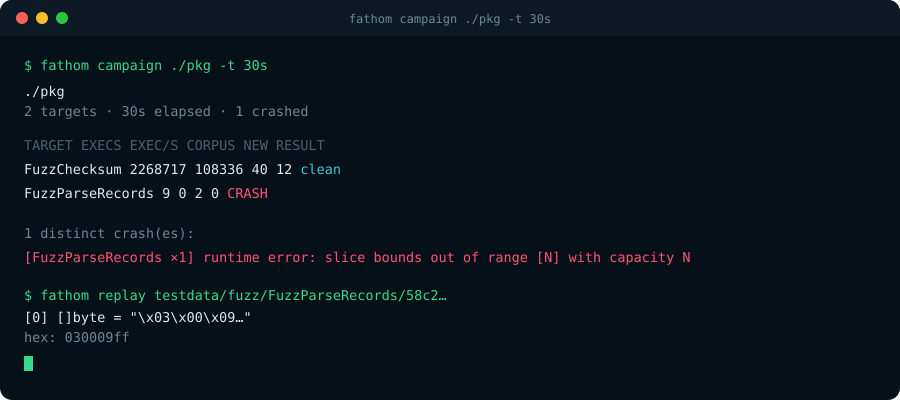
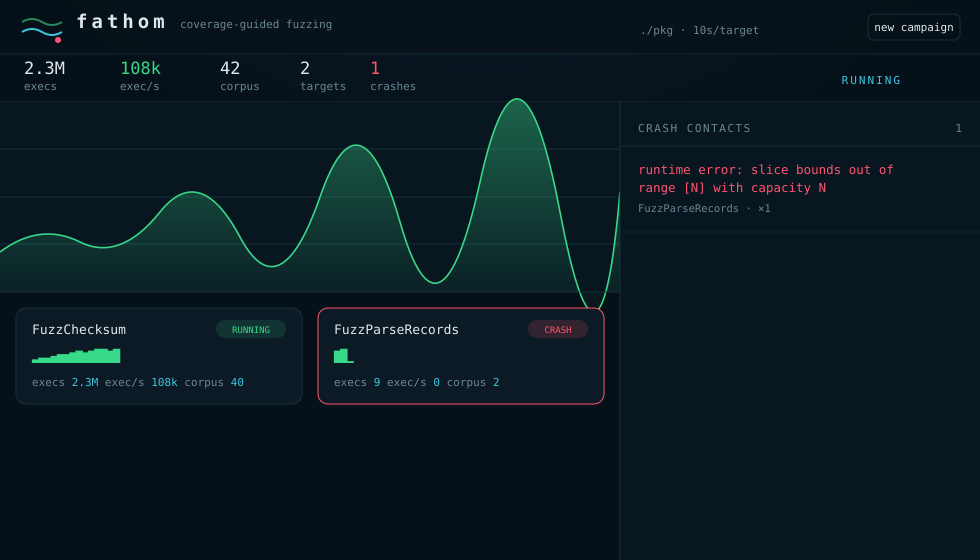
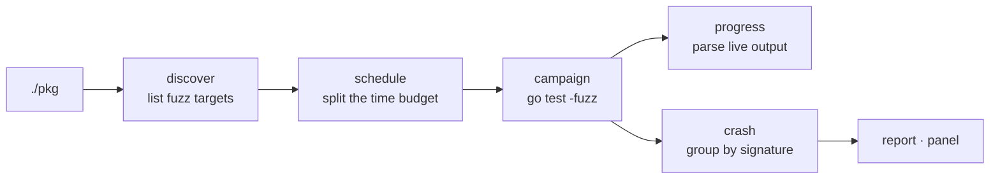

<picture>
  <source media="(prefers-color-scheme: dark)" srcset="docs/assets/wordmark-dark.svg">
  
</picture>

[](https://github.com/cansarihan/fathom/actions/workflows/ci.yml)
[](https://github.com/cansarihan/fathom/actions/workflows/codeql.yml)
[](https://goreportcard.com/report/github.com/cansarihan/fathom)
[](go.mod)
[](LICENSE)

Fathom is a campaign orchestrator for Go's native fuzzer. `go test -fuzz` is a
strong coverage-guided engine, but it fuzzes one target at a time and reports to
a terminal. Fathom finds every fuzz target in a package, splits a time budget
across them, runs each while reading the live status the engine prints, and
collects the failing inputs — grouped by the fault they trigger — into one
report or one live panel.

It does not reimplement the fuzzer. The coverage-guided intelligence stays in the
toolchain; Fathom is the scheduling, the tracking and the triage around it. One
binary with nothing outside the standard library.

## On the command line

```console
$ fathom campaign ./pkg -t 30s
./pkg
2 targets · 30s elapsed · 1 crashed

TARGET            EXECS      EXEC/S   CORPUS  NEW  RESULT
FuzzChecksum      2268717    108336   40      12   clean
FuzzParseRecords  9          0        2       0    CRASH

1 distinct crash(es):
  [FuzzParseRecords ×1] runtime error: slice bounds out of range [N] with capacity N
```



## The panel

`fathom serve` hosts a panel that reads like a depth sounder: the aggregate
exec rate scrolls across an echogram, each target is a card with its own live
sparkline, and a crash surfaces on the right as a contact — the distinct fault,
not the hundredth duplicate input that found it.



## How a campaign runs



1. `discover` asks `go test -list` which fuzz targets the package defines.
2. `schedule` splits the total time across them, evenly or by weight.
3. `campaign` runs each target through the toolchain, parsing the execs/sec,
   baseline and minimizing lines as they stream.
4. When a target fails, the recorded input is read and reduced to a crash with a
   stable signature; `crash` groups the campaign's failures so one bug is one
   contact.

## Keeping your source clean

A fuzzing run writes new corpus and crash files into the package's `testdata`.
On the command line that is what you want. `serve` instead copies the package
into a throwaway module and fuzzes that, so a panel left running never rewrites
your tree.

## Commands

```console
$ fathom targets ./pkg              # list the package's fuzz targets
$ fathom run ./pkg FuzzName -t 30s  # fuzz one target with live progress
$ fathom campaign ./pkg -t 60s      # fuzz every target and report crashes
    -history <file>   append the campaign to a JSON history
    -json             print JSON instead of a table
$ fathom corpus ./pkg               # summarize a target's recorded inputs
$ fathom crashes ./pkg              # list recorded failing inputs
$ fathom replay <file>              # decode a crash input
$ fathom history <file>             # list past campaigns from a history file
$ fathom serve -dir ./pkg           # host the panel and API
    -t <dur>          fuzz time per target
    -listen <addr>    listen address (default 127.0.0.1:8080)
    -token <tok>      require a bearer token (or FATHOM_TOKEN)
$ fathom version
```

## HTTP API

```console
GET  /api/v1/status                  build info and the package being fuzzed
GET  /api/v1/targets                 the package's fuzz targets
GET  /api/v1/campaigns               recent campaigns, newest first
POST /api/v1/campaigns               start a campaign over every target
GET  /api/v1/campaigns/{id}          one campaign with per-target state
GET  /api/v1/campaigns/{id}/stream   server-sent events for a running campaign
```

## Run the demo

The demo fuzzes a small, deliberately fragile record parser; the engine finds the
bounds bug in well under a second.

```sh
cd fathom
make demo          # panel at http://127.0.0.1:18160
make demo-down
```

Or without Docker:

```sh
make run           # serves the panel over the sample package on 127.0.0.1:8080
```

## Build

```sh
make build         # ./bin/fathom
make test          # unit and integration tests
make race          # tests under the race detector
make lint          # golangci-lint
```

Fathom shells out to `go test -fuzz`, so it needs the Go toolchain on the host.

## License

MIT. See [LICENSE](LICENSE).
