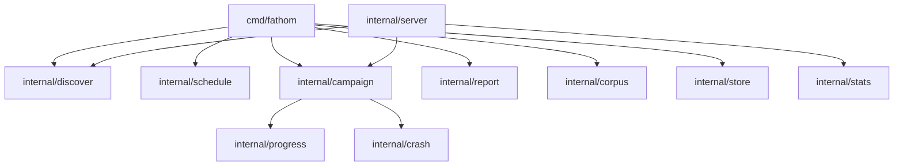

# Architecture

Fathom does not fuzz. The Go toolchain fuzzes; Fathom drives it, reads what it
says, and turns a raw campaign into something you can schedule, watch and triage.
Each package owns one part of that job.

## The idea

`go test -fuzz` is a capable coverage-guided fuzzer, but it fuzzes one target at
a time and reports to a terminal. Fathom wraps it: it finds the targets in a
package, splits a time budget across them, runs each one while parsing the live
status it prints, and collects the failing inputs — deduplicated by the fault
they trigger — into one report or one panel.

Nothing reimplements the engine. The intelligence that grows coverage stays in
the toolchain; Fathom is the orchestration and the analytics around it.

## Packages

- `internal/discover` asks `go test -list` which fuzz targets a package defines.
  It compiles the test binary but runs nothing.
- `internal/progress` parses the engine's live output — the execs/sec status
  lines, the baseline phase, the minimizing phase, and the line that announces a
  failing input — into typed events. It is pure and is the most heavily tested
  package.
- `internal/campaign` runs one target through the toolchain for a bounded time,
  feeds every line to `progress`, and when the target fails, reads the recorded
  input and builds a crash. Cancelling the context stops the run.
- `internal/crash` decodes the `go test fuzz v1` corpus format, reduces a panic
  to a stable signature, and groups crashes so one bug found a hundred times is
  reported once.
- `internal/schedule` splits a campaign's total time across its targets, evenly
  or by weight.
- `internal/corpus` inventories a target's inputs by content hash and summarizes
  them.
- `internal/stats` keeps the exec-rate time series in a bounded ring and renders
  a sparkline.
- `internal/store` persists a campaign history as JSON.
- `internal/report` renders a campaign as a table or JSON.
- `internal/server` wraps the engine in an HTTP API and serves the panel. It
  fuzzes a copy of the target package in a temp directory, so a run's generated
  corpus and crash files never land in the served source tree.

## Keeping the source clean

A fuzzing run writes new corpus entries and crash inputs into the package's
`testdata`. That is the right behaviour on the command line, but a server
fuzzing the same directory on every request would rewrite the tree underneath
it. So `serve` copies the package's Go files into a throwaway module first and
fuzzes that, discarding it when the campaign ends.

## What it does not do

Fathom needs the Go toolchain on the host — it shells out to `go test`. It
orchestrates Go's native fuzzer and does not instrument or fuzz other languages.
It reads the engine's text output, so a future change to that format is the one
thing that could need a parser update; that parser lives in one small, tested
package for exactly that reason.
